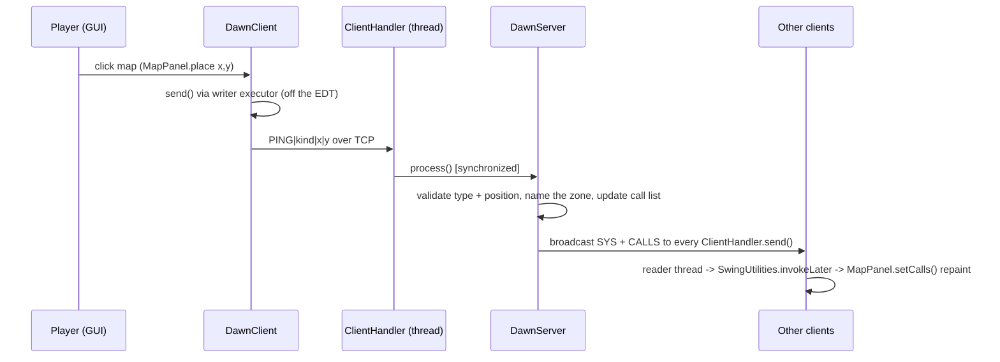

# DawnRoom - MLBB Map Meeting (Java LAN Chat)

**Course / Section:** ITAS1 - Network Programming - _[your section]_
**School:** Iloilo State University of Fisheries and Technology (ISUFST)
**Instructor:** Kenth Joshua Espinia
**Repository:** `ITAS1-[Section]-Ladiao-Pumaren`
**Final commit hash submitted:** `4ebaa55`

> Fan-made school project. Not affiliated with or endorsed by Moonton. The map is a simplified original drawing made with Java2D; no game art, icons, or assets are used.


*DawnRoom running on the LAN: the Lane/Tactical Map tools on the left, the online list and group chat on the right.*

---

## Table of Contents
1. [Members](#members)
2. [Project Overview](#project-overview)
3. [Concept Proposal and Approval](#concept-proposal-and-approval)
4. [User Problem and Theme](#user-problem-and-theme)
5. [Core Features](#core-features)
6. [Original Theme Features](#original-theme-features)
7. [Commands](#commands)
8. [Architecture](#architecture)
9. [Message Format](#message-format)
10. [Setup Instructions](#setup-instructions)
11. [Screenshots](#screenshots)
12. [Test Results](#test-results)
13. [Division of Responsibilities](#division-of-responsibilities)
14. [Contribution Log](#contribution-log)

---

## Members

| Name | GitHub | Email | Main work |
|---|---|---|---|
| Raymart D. Ladiao | [@raymartladiao](https://github.com/raymartladiao) | raymartladiao@gmail.com | Project creator and developer |
| Dyanne Grace V. Pumaren | [@dyannegracevpumaren87](https://github.com/dyannegracevpumaren87) | dyannegracevpumaren87@isufst.edu.ph | Project operator |

**Course and section:** ITAS1 - _[your section]_
**Submission:** November 23-27, 2026

---

## Division of Responsibilities

| Member | Responsibility | Description |
|---|---|---|
| **Raymart D. Ladiao** | Project Creator | Created and developed the DawnRoom project. |
| **Dyanne Grace V. Pumaren** | Project Operator | Operates the DawnRoom application. |

---

## Project Overview

**DawnRoom** is a Java LAN chat application for **Mobile Legends: Bang Bang (MLBB)** squads who hold a quick **map meeting** before a match.

It is built with:
- Java `ServerSocket` / `Socket` (TCP)
- one thread per connected client on the server
- a purple **Swing** GUI on the client
- in-memory shared state (no database, no accounts)

One computer runs the server. Any number of clients on the same LAN or Wi-Fi connect by typing the server IP and port, then chat, claim lane roles, and place calls on a shared map.

---

## Concept Proposal and Approval

| Item | Details |
|---|---|
| **Theme** | Esports Team Room - MLBB map meeting |
| **Audience** | 5-player MLBB squads planning a match together |
| **Problem** | In an ordinary group chat, "who takes which lane?" and "where do we rotate, take Turtle, or take Lord?" turn into long typed messages that are slow, unclear, and easy to miss. |
| **Feature 1** | **Lane Lineup board** - live, server-validated role slots shared by all clients |
| **Feature 2** | **Shared tactical map** - click-to-call markers that appear on every client |
| **Sample screens** | See [Screenshots](#screenshots) |
| **Instructor approval** | _[Instructor name, date]_ |

---

## User Problem and Theme

Squad communication before an MLBB match needs to be fast and exact. Plain text cannot point at a place on the map, and it cannot enforce rules such as "only one player per lane."

DawnRoom goes beyond ordinary messaging by turning those two needs into **shared, server-controlled state**:

- the lineup is a single source of truth, so two players can never hold the same role;
- a map call is a position on a shared board, so everyone sees the same marker, the caller's nickname, and the area name that the **server** works out.

Visual style (purple theme, custom buttons, map drawing) is original to this project. The originality comes from the two features below, not from colors or a background.

---

## Core Features

- Configurable server **IP and port** in the GUI, with validation
- Unique, validated **nicknames**
- **Group chat**: each message is broadcast once to every client, including the sender, with sender nickname and time
- **Online user list** that updates on join, leave, and rename
- Join, leave, and rename notices sent to everyone
- Commands `/name`, `/exit`, `/help`
- Blank-message rejection and friendly connection error messages
- Messages kept in the conversation area for the whole session
- GUI stays responsive: all blocking network work runs off the Event Dispatch Thread
- Sockets and streams are released on exit or disconnect

---

## Original Theme Features

### Feature 1 - Lane Lineup board
Five role slots: **EXP Lane, Mid Lane, Gold Lane, Jungler, Roamer**.

- Each player can claim one open slot. A slot can only be held by one player.
- Claiming a new slot automatically frees the old one.
- The **shotcaller** (the longest-connected player) can assign a role to any player or clear the whole lineup. If the shotcaller leaves, the role passes to the next player automatically.
- The server announces `LINEUP COMPLETE` in chat when all five roles are filled.
- When a player leaves, their role is freed on every client.

### Feature 2 - Shared tactical map
A drawn 3-lane map (EXP Lane, Mid Lane, Gold Lane, Turtle pit, Lord pit, both bases).

- A player picks a call type (**Attack, Defend, Gank, Turtle, Lord, Danger**) and clicks a spot.
- The marker appears on **every** client with the caller's nickname.
- The **server** names the area ("Mid Lane", "Lord Pit", "Gold-side Jungle", ...) and posts the call in chat.
- Each player keeps at most 5 calls (oldest dropped). Players can undo their last call. Only the shotcaller can clear the map.

Both features exchange data through the server, and the server (not the GUI) checks every rule.

---

## Commands

| Command | Effect |
|---|---|
| `/name <newname>` | Change nickname (validated and unique). Everyone is updated. |
| `/exit` | Leave the room cleanly |
| `/help` | Show the list of commands |

**Nickname rules:** 1-20 characters; letters, numbers, `_`, `.`, `-`; unique (case-insensitive).
**Message rules:** not blank; maximum 500 characters.

---

## Architecture

```
 +------------+   TCP   +--------------------------------+   TCP   +------------+
 | DawnClient |<------->| DawnServer (accept loop)       |<------->| DawnClient |
 | Swing GUI  |         |  + ClientHandler (1 thread/cl) |         | Swing GUI  |
 | + MapPanel |         |  shared state (synchronized):  |         | + MapPanel |
 +------------+         |  clients | lane lineup | calls |         +------------+
                        +--------------------------------+
```

| File | Responsibility |
|---|---|
| `src/Protocol.java` | Message framing: build and parse one line |
| `src/Board.java` | Shared map geometry, role list, call types, `zoneAt(x, y)` (used by server and client) |
| `src/DawnServer.java` | Accept loop, all shared state, validation, broadcasts |
| `src/ClientHandler.java` | One thread per client: read lines, hand them to the server, safe `send` |
| `src/DawnClient.java` | Main Swing window, networking threads, incoming message handling |
| `src/MapPanel.java` | Draws the tactical map and turns clicks into board coordinates |
| `src/Theme.java` | Purple colors and custom buttons |
| `test/HeadlessTest.java` | Automated check of the server rules over real sockets (no GUI) |

### Message path (example: a map call)



### Concurrency and reliability
- All shared state is touched only inside `synchronized` methods of `DawnServer`.
- `ClientHandler.send()` is `synchronized`, so two broadcasts never interleave their lines.
- Roles and calls store the owner's **client id**, not the nickname, so renames never corrupt them.
- Shotcaller-only actions are checked on the **server**, not just disabled in the GUI.
- On the client, a reader thread blocks on the socket; every UI change goes through `SwingUtilities.invokeLater`; outgoing writes use a single-thread executor so the GUI never blocks.
- Connection attempts time out after 4 seconds, and a client that does not send `JOIN` within 15 seconds is dropped.
- When a client disconnects (cleanly or abruptly), its socket is closed, its roles and calls are removed, and the server and the other clients keep running.

---

## Message Format

One line per message: `TYPE|field|field|...`

Every field is URL-encoded, so a `|` or a newline typed by a user can never break framing. Defined in `src/Protocol.java`.

**Client to server**
```
JOIN|nick                    join with a nickname (must be the first message)
MSG|text                     chat text; also carries /name, /exit, /help
ROLE|role                    claim a lineup role
ROLEFREE                     release my role
ROLEASSIGN|role|nick         shotcaller assigns a role to a player
ROLECLEAR                    shotcaller clears the lineup
PING|kind|x|y                place a map call
PINGUNDO                     remove my latest call
PINGCLEAR                    shotcaller clears the map
```

**Server to client**
```
OK|nick                      join accepted
ERR|text                     request rejected, with a readable reason
CHAT|time|sender|text        a chat message
SYS|time|text                a system notice (join, leave, rename, role, call)
USERS|n1|n2|...              the online list
YOU|nick                     your current nickname (after /name)
SHOTCALLER|nick              who the shotcaller is
ROLES|n|(role,holder)*       the full lineup
CALLS|n|(id,kind,x,y,nick,time,zone)*    all map calls
BYE                          the server accepted /exit
```

Map coordinates are integers from 0 to 1000 (origin top-left). The server rejects anything else.

---

## Setup Instructions

### Requirements
| Item | Value |
|---|---|
| Java | **JDK 17 or newer** (developed and run on Java 21) |
| IDE / build tool | Apache NetBeans 31 (or any IDE), or the command line |
| Dependencies | None (standard Java library only) |
| Network | All computers on the **same LAN / Wi-Fi** |

### Option A - Command line
```bash
javac -d out src/*.java
java -cp out DawnServer 5001        # port is optional (default 5000); the server prints the LAN IPs to use
java -cp out DawnClient             # run once per client
```

### Option B - Scripts
Run in order: `0-compile`, `1-start-server`, `2-start-client`
(`.bat` on Windows, `.sh` on Mac/Linux).

### Option C - NetBeans
1. Open the project and set the main class to `DawnServer`, then run it. Note the IP printed in the Output window.
2. Run `DawnClient` once per client (right-click the file, then **Run File**).

### LAN demonstration (two computers, three clients)
1. **Computer A:** start the server. It prints something like:
   ```
   DawnRoom server listening on port 5001
   Clients on the LAN can connect using one of these IPs:
     192.168.0.112  (Intel(R) Dual Band Wireless-AC 8265)
   ```
2. **Computer A:** start one client. Enter the printed IP (or `localhost`), port `5001`, a nickname, then click **Connect**.
3. **Computer B:** start two clients. Enter Computer A's IP and the same port, with different nicknames.
4. The first player to connect becomes the **shotcaller**.

### Troubleshooting
| Problem | Fix |
|---|---|
| "Connection refused" / cannot connect | Make sure the server is running and the IP and port match what the server printed. |
| Works on `localhost` but not from another PC | Allow Java through the Windows firewall (or open the port) on the server computer. |
| Both PCs seem on the same network but fail | Avoid guest or school networks with client isolation; use a phone hotspot or a normal router. |
| "Port in use" | Start the server with another port, for example `java -cp out DawnServer 5002`. |
| "Nickname already in use" | Pick a different nickname; nicknames are case-insensitive. |
| `javac` not found | Install a JDK (not just a JRE) and make sure it is on your PATH. |

### Optional automated server check (no GUI)
```bash
javac -cp out -d test-out test/HeadlessTest.java
java -cp out:test-out HeadlessTest      # Windows: use ; instead of :
```
`HeadlessTest` starts its own server on port 5055 and checks the protocol rules over real sockets.

---

## Screenshots

All screenshots are stored in [`docs/`](docs/).

**1. Server running (NetBeans Output).** Server listening on port 5001 and printing the LAN IP.


**2. Client start screen.** Server IP, Port, Nickname, and Connect controls; the map is locked until connected.


**3. Connection details filled in.** LAN IP `192.168.0.112`, port `5001`, nickname `Raymart`, before connecting.


**4. Connected as the first player.** Raymart is shown as `[SHOTCALLER]`; the tactical map and call buttons are active.


**5. Second client joins.** Online list updates to 2 and the join notice appears.


**6. Group chat.** Messages show sender nickname and time and reach everyone.


**7. Chat continues.** More messages between the two clients.


**8. A client leaves.** The "left the room" notice appears and the online list drops to 1.


**9. Clean disconnect.** After clicking **Disconnect**, the GUI returns to its start state and the chat shows "Disconnected."


> **Still to add before submitting:** screenshots of (a) three clients connected across two computers, (b) a Lane Lineup with roles claimed, (c) map calls from two different clients, and (d) the invalid IP/port and unavailable-server error messages. Save them in `docs/` and link them here.

---

## Test Results

**How results were gathered**
- **Automated:** `HeadlessTest` run on 2026-11-24 with OpenJDK 21: **32 passed, 0 failed**. It tests the server over real TCP sockets with three clients.
- **Manual / GUI:** screenshots above, taken on the LAN.
- Rows marked **PENDING** still need a manual run and a screenshot.

| # | Test | Steps | Expected | Actual | Status |
|---|---|---|---|---|---|
| 1 | Three concurrent clients | Start server, connect 3 clients | All appear in the online list | HeadlessTest: 3 clients joined and every client received a 3-user list. GUI screenshots (#5) show 2 clients. | PASS (automated) - add 3-client LAN screenshot |
| 2 | Broadcast to all | Client A sends a message | All clients, including A, get it once with nickname + time | HeadlessTest: all 3 clients received it. GUI screenshot #6 shows `Raymart: Hello` and `Dyanne: Hi` with timestamps. | PASS |
| 3 | Online list updates | Join, leave, rename | List updates on all clients | Screenshots #5 and #8: Online (1) to (2) on join, back to (1) on leave. Rename covered by HeadlessTest. | PASS |
| 4 | Valid nickname change | `/name newnick` | Everyone notified; list and roles updated | HeadlessTest: rename notified all and updated the lineup holder name. | PASS (automated) |
| 5 | Duplicate nickname | `/name` an existing nick; join with an existing nick | Error shown, no change | HeadlessTest: both rejected with "already in use". | PASS (automated) |
| 6 | Blank message | Send empty or spaces | Rejected with an error | HeadlessTest: rejected with "Message cannot be blank." | PASS (automated) |
| 7 | Invalid IP / port | Enter `999.1.1.1`, port `abc` | Helpful error, no crash | Validation is in `DawnClient.connect()`. | PENDING (run and screenshot) |
| 8 | Unavailable server | Connect while the server is stopped | Error message, GUI not frozen | Client uses a 4-second connect timeout off the GUI thread. | PENDING (run and screenshot) |
| 9 | Clean `/exit` | Type `/exit` | Others see "left"; socket closed | HeadlessTest: server replied `BYE` and the other client's list shrank. Screenshots #8-#9 show the leave notice and the clean disconnect. | PASS |
| 10 | Abrupt disconnect | Kill a client process | Server and others keep working | HeadlessTest: a client's socket was closed abruptly and the others saw the list shrink. | PASS (automated) |
| 11 | Continued chat | After #10, the remaining clients chat | Works | HeadlessTest: chat delivered between remaining clients. | PASS (automated) |
| 12 | Lineup sync | A claims Mid Lane, B claims Jungler | Same lineup on all clients | HeadlessTest: claim synced to another client. | PASS (automated) - add GUI screenshot |
| 13 | Role conflict | B claims a role A holds | Refused; lineup unchanged | HeadlessTest: refused with "already taken". | PASS (automated) |
| 14 | One role per player | Claim a second role | Old role becomes OPEN everywhere | HeadlessTest: previous role freed. | PASS (automated) |
| 15 | Shotcaller assign | Non-shotcaller tries Assign, then shotcaller assigns | First refused; second updates all clients | HeadlessTest: "Only the shotcaller..." then the assignment synced. Unknown player also refused. | PASS (automated) |
| 16 | Map call sync | B clicks the mid lane with Gank (from computer 2) | Marker and nickname on all clients; chat shows zone | HeadlessTest: call synced with owner, kind `GANK`, zone `Mid Lane`. | PASS (automated) - add GUI screenshot |
| 17 | Call limits | B places 7 calls | Only newest 5 remain; Undo removes the latest | HeadlessTest: 5 kept; undo removed one. | PASS (automated) |
| 18 | Clear map (shotcaller only) | B tries Clear, then the shotcaller clears | B refused; map empty on all clients | HeadlessTest: refused, then cleared for everyone. | PASS (automated) |
| 19 | Shotcaller handoff | Shotcaller disconnects | Next player becomes shotcaller; their roles freed | HeadlessTest: shotcaller passed to the next player and the leaver's role was freed. | PASS (automated) |
| 20 | Invalid map input | Unknown call type; position outside 0-1000; non-numeric position | Each refused with an error | HeadlessTest: all three refused. | PASS (automated) |

---

## Contribution Log

> Replace the placeholders with your real dated tasks and commit links.

| Date | Member | Task | Commit |
|---|---|---|---|
| _[date]_ | Raymart D. Ladiao (@raymartladiao) | _[task]_ | `4ebaa55` |
| _[date]_ | Dyanne Grace V. Pumaren (@dyannegracevpumaren87) | _[task]_ | N/A |

**Checkpoints:** (1) theme and concept approval - _[date]_; (2) working server and multi-client group chat - _[date]_; (3) integrated original features and testing - _[date]_; (4) final submission and demonstration - _[date]_.

---
